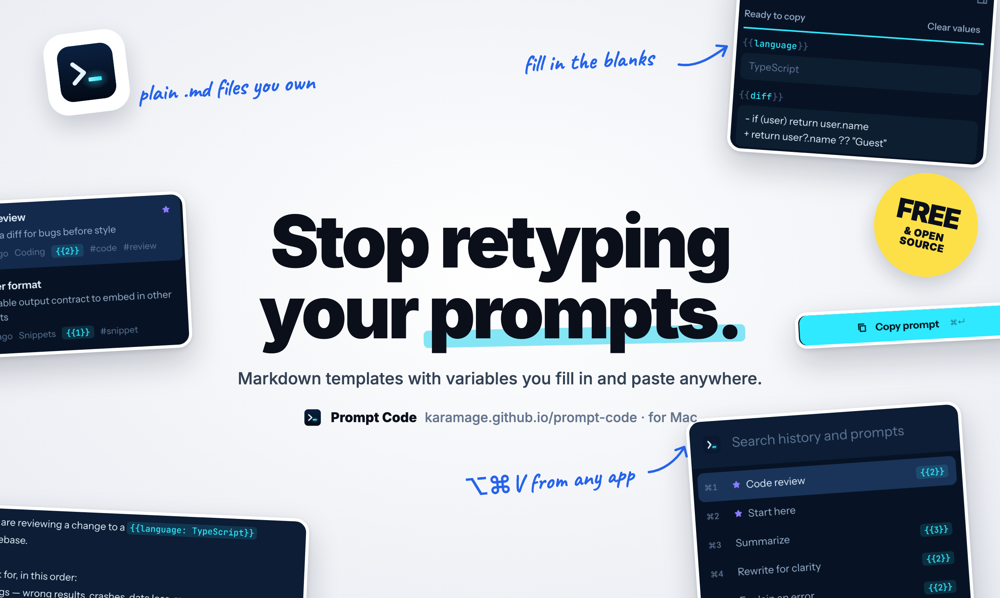
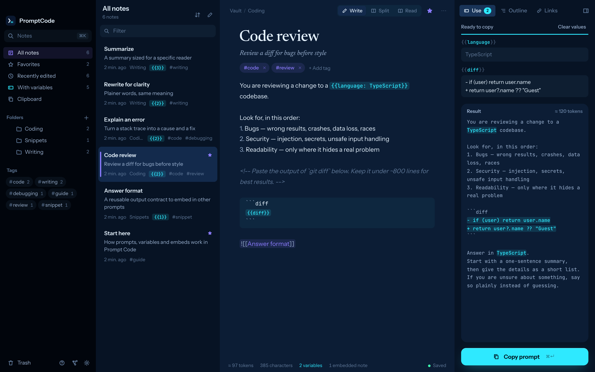
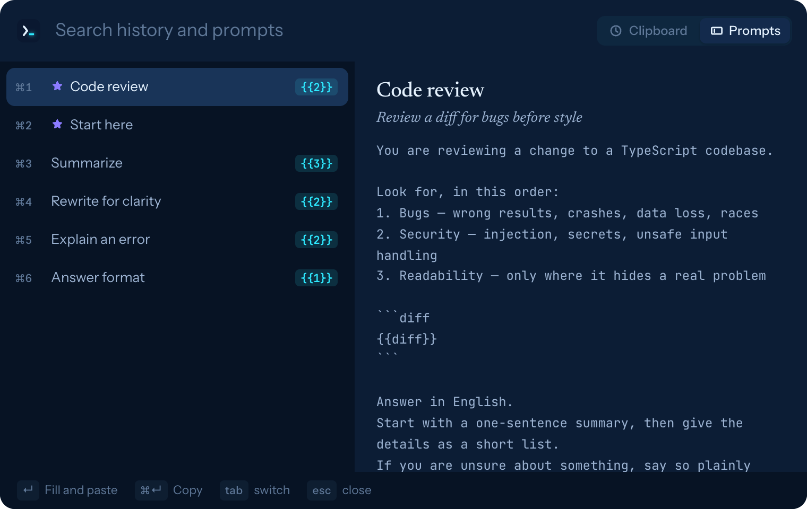

# Prompt Code

<p align="center"><a href="https://karamage.github.io/prompt-code/fr/"></a></p>

[](https://github.com/karamage/prompt-code/actions/workflows/ci.yml)
[](https://github.com/karamage/prompt-code/releases/latest)
[](LICENSE)


[](https://tauri.app/)
[](https://www.rust-lang.org/)
[](https://www.typescriptlang.org/)
[](https://react.dev/)
[](https://codemirror.net/)
[](https://hono.dev/)
[](https://bun.sh/)
[](https://github.com/saghul/txiki.js)

Un éditeur Markdown et gestionnaire d’extraits pour les prompts d’IA, pour macOS.

Prompt Code reprend d’Obsidian ce qui rend l’écriture agréable — de simples fichiers Markdown dans un dossier qui vous appartient, des `[[liens]]`, des rétroliens, un graphe, une palette de commandes — et de massCode ce qui rend la réutilisation rapide — dossiers, tags, favoris, copie en un clic. Il y ajoute ce dont les prompts ont besoin : des variables à remplir, des fragments réutilisables intégrés et des notes pour vous-même qui n’atteignent jamais le modèle.

[Site web](https://karamage.github.io/prompt-code/fr/) · [Télécharger](https://github.com/karamage/prompt-code/releases/latest)

[English](README.md) · [日本語](README.ja.md) · [简体中文](README.zh-CN.md) · [한국어](README.ko.md) · [Español](README.es.md) · [Deutsch](README.de.md) · Français



## Ce que vous pouvez faire

- **Variables.** Écrivez `{{topic}}`, `{{audience: engineers}}` (valeur par défaut) ou `{{tone: friendly | formal}}` (choix). Le panneau **Utiliser** les transforme en champs et affiche le prompt final au fil de la frappe. `⌘↵` le copie.
- **Intégrations.** `![[Format de réponse]]` insère une autre note au moment de la copie. Gardez un persona ou un format de sortie à un seul endroit et intégrez-le partout.
- **Notes pour vous.** `<!-- comme ceci -->` reste dans le fichier et disparaît à la copie.
- **Liens et tags.** Liens `[[Note]]` avec autocomplétion, rétroliens, `#tags` et vue en graphe (`⌘G`). Renommer une note réécrit les liens qui y mènent.
- **Navigation rapide.** `⌘K` ouvre n’importe quelle note, `>` lance des commandes, `⇧⌘F` cherche dans le texte de toutes les notes.
- **Vos fichiers, tels quels.** Le coffre est un dossier de fichiers `.md` avec un frontmatter YAML (`tags`, `favorite`, `description`). Modifiez-les avec n’importe quelle autre app : Prompt Code prend en compte les changements en direct. Les notes supprimées vont dans `.trash/` à l’intérieur du coffre.
- **Collage rapide depuis n’importe où.** Appuyez sur `⌥⌘V` dans n’importe quelle app pour ouvrir une petite fenêtre avec l’historique du presse-papiers et vos prompts. Choisissez-en un : il est collé directement dans l’app que vous utilisiez. Pour les prompts avec variables, vous les remplissez d’abord sur place.
- **Historique du presse-papiers dans la barre des menus.** Prompt Code reste dans la barre des menus et conserve le texte que vous copiez (200 éléments par défaut). Les copies que les gestionnaires de mots de passe marquent comme masquées ne sont jamais enregistrées. Les derniers éléments copiés et les prompts favoris sont à un clic dans le menu de la barre des menus.
- **Écrire, scinder, lire.** Un éditeur Markdown avec coloration syntaxique des blocs de code, et une vue de lecture.
- Thèmes clair et sombre, cinq couleurs d’accent. L’interface de l’app est en anglais et en japonais.

<p align="center"></p>

Rien ne quitte votre Mac. Prompt Code n’a ni compte ni télémétrie et n’effectue aucune requête réseau.

Pour coller dans d’autres apps, macOS vous demande la première fois d’autoriser Prompt Code dans **Réglages Système › Confidentialité et sécurité › Accessibilité**. Sans cette autorisation, le collage rapide copie tout de même le texte, que vous collez avec `⌘V`. Fermer la fenêtre laisse Prompt Code dans la barre des menus ; quittez-le depuis le menu de la barre des menus ou avec `⌘Q`.

## Raccourcis

| Touche | Action |
| --- | --- |
| `⌘K` | Aller à une note (tapez `>` pour les commandes) |
| `⌘N` / `⇧⌘N` | Nouvelle note / nouveau dossier |
| `⇧⌘F` | Chercher dans toutes les notes |
| `⌘↵` | Remplir les variables ; dans le panneau, copier |
| `⇧⌘C` | Copier le prompt avec les valeurs actuelles |
| `⌘E` | Basculer entre écriture et lecture |
| `⌘\` | Masquer ou afficher les barres latérales |
| `⌘G` | Graphe |
| `⌘D` | Dupliquer la note |
| `⌘⌫` | Mettre la note à la corbeille (annulable depuis la notification) |
| `⌘,` | Réglages |
| `⌥⌘V` (partout) | Collage rapide — modifiable dans les Réglages |
| `↵` / `⌘↵` / `⌘1`–`⌘9` | Dans le collage rapide : coller / copier seulement / coller cette ligne |
| `⌘`-clic | Suivre un `[[lien]]` dans l’éditeur |

## Compiler

Prérequis : macOS 11 ou ultérieur, [Bun](https://bun.sh) et Rust (rustup installe automatiquement la toolchain de `rust-toolchain.toml`).

```sh
bun install
bun run app:build        # src-tauri/target/release/bundle/macos/Prompt Code.app
bun run app:dmg          # un DMG non signé
bun run release:mac      # DMG signés et notarisés (nécessite un Developer ID ; voir le script)
```

Développer dans un navigateur :

```sh
bun run build:client && bun run dev:server   # http://127.0.0.1:4721
bun run dev:client                            # Vite avec rechargement à chaud sur :5183 (proxy de /api)
bun run check                                 # types, lint, vérification du format, tests
```

`dev:server` accepte `--vault <dir>` pour ouvrir un autre dossier. Les réglages sont dans `~/.config/prompt-code/` (modifiable avec `PROMPT_CODE_HOME`). Le coffre par défaut est `~/PromptCode`.

## Comment elle est construite

L’app est volontairement légère : environ 12 Mo sur le disque et environ 40 Mo de mémoire pour le backend.

- **Tauri** fournit la fenêtre à l’aide du WebKit du système : aucun moteur de navigateur n’est embarqué.
- L’interface (React, CodeMirror 6) et l’API (Hono) sont servies par un serveur local lié à `127.0.0.1` sur un port aléatoire. Chaque appel à l’API exige un jeton que l’app génère au lancement.
- Ce serveur tourne sur **[txiki.js](https://github.com/saghul/txiki.js)**, un runtime JavaScript d’environ 6 Mo basé sur QuickJS, au lieu d’embarquer Bun ou Node (~60 Mo). En développement, le même code tourne sur Bun ; `src/server/runtime/` masque les différences.
- `scripts/build-server.ts` regroupe le serveur en un seul fichier et télécharge un binaire txiki.js vérifié par somme de contrôle comme sidecar Tauri.

```
src/
  shared/   frontmatter, syntaxe des prompts, métadonnées des notes (partagés, testés unitairement)
  server/   coffre (index, surveillance, recherche, corbeille), API HTTP, runtimes (Bun / txiki.js)
  client/   interface React, extensions CodeMirror, aperçu Markdown
src-tauri/  l’enveloppe native : lance le sidecar et y fait pointer la fenêtre
```

## Licence

MIT
