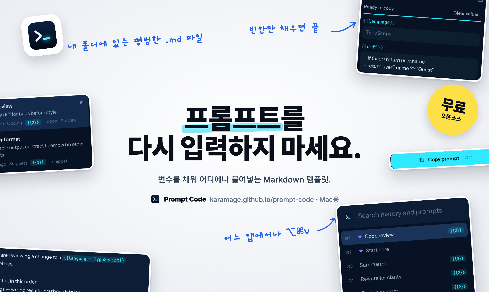

# Prompt Code

<p align="center"><a href="https://karamage.github.io/prompt-code/ko/"></a></p>

[](https://github.com/karamage/prompt-code/actions/workflows/ci.yml)
[](https://github.com/karamage/prompt-code/releases/latest)
[](LICENSE)


[](https://tauri.app/)
[](https://www.rust-lang.org/)
[](https://www.typescriptlang.org/)
[](https://react.dev/)
[](https://codemirror.net/)
[](https://hono.dev/)
[](https://bun.sh/)
[](https://github.com/saghul/txiki.js)

AI 프롬프트를 위한 macOS용 Markdown 에디터 겸 스니펫 관리자입니다.

Prompt Code는 Obsidian에서 글쓰기를 즐겁게 만드는 부분을 가져왔습니다. 내 폴더에 두는 평범한 Markdown 파일, `[[링크]]`, 백링크, 그래프, 명령 팔레트입니다. massCode에서는 재사용을 빠르게 만드는 부분을 가져왔습니다. 폴더, 태그, 즐겨찾기, 원클릭 복사입니다. 그 위에 프롬프트에 필요한 것을 더했습니다. 채워 넣는 변수, 재사용하는 임베드 조각, 모델에는 절대 전달되지 않는 나만의 메모입니다.

[웹사이트](https://karamage.github.io/prompt-code/ko/) · [다운로드](https://github.com/karamage/prompt-code/releases/latest)

[English](README.md) · [日本語](README.ja.md) · [简体中文](README.zh-CN.md) · 한국어 · [Español](README.es.md) · [Deutsch](README.de.md) · [Français](README.fr.md)


## 할 수 있는 일

- **변수.** `{{topic}}`, `{{audience: engineers}}`(기본값), `{{tone: friendly | formal}}`(선택지)처럼 씁니다. **사용** 패널이 이를 입력란으로 바꾸고, 입력하는 동안 완성된 프롬프트를 보여 줍니다. `⌘↵`로 복사합니다.
- **임베드.** `![[답변 형식]]`은 복사할 때 다른 노트의 내용을 끌어옵니다. 페르소나나 출력 형식 규칙을 한곳에 두고 어디에나 임베드하세요.
- **나를 위한 메모.** `<!-- 이렇게 -->` 쓴 내용은 파일에 남고 복사할 때 제거됩니다.
- **링크와 태그.** 자동 완성되는 `[[노트]]` 링크, 백링크, `#태그`, 그래프 보기(`⌘G`). 노트 이름을 바꾸면 그 노트를 가리키는 링크도 다시 써집니다.
- **빠른 이동.** `⌘K`로 어떤 노트로든 이동하고, `>`로 명령을 실행하며, `⇧⌘F`로 모든 노트의 본문을 검색합니다.
- **파일은 있는 그대로.** 보관소는 YAML frontmatter(`tags`, `favorite`, `description`)가 붙은 `.md` 파일이 담긴 폴더입니다. 다른 앱으로 편집해도 Prompt Code가 변경 사항을 바로 반영합니다. 삭제한 노트는 보관소 안의 `.trash/`로 이동합니다.
- **어디서든 빠른 붙여넣기.** 어떤 앱에서든 `⌥⌘V`를 누르면 클립보드 기록과 프롬프트가 담긴 작은 창이 열립니다. 하나를 고르면 쓰고 있던 앱에 바로 붙여넣어집니다. 변수가 있는 프롬프트는 그 자리에서 먼저 값을 채울 수 있습니다.
- **메뉴 막대의 클립보드 기록.** Prompt Code는 메뉴 막대에 머물며 복사한 텍스트를 보관합니다(기본 200개). 암호 관리자가 숨김으로 표시한 복사 내용은 기록하지 않습니다. 최근 클립과 즐겨찾는 프롬프트는 메뉴 막대 메뉴에서 한 번에 고를 수 있습니다.
- **쓰기, 분할, 읽기.** 코드 블록 구문 강조를 지원하는 Markdown 에디터와 읽기 보기.
- 라이트·다크 테마와 다섯 가지 강조 색상. 앱 화면은 영어와 일본어를 지원합니다.

<p align="center"></p>

Mac 밖으로 나가는 것은 없습니다. Prompt Code에는 계정도 원격 측정도 없고, 네트워크 요청도 하지 않습니다.

다른 앱에 처음 붙여넣을 때 macOS가 **시스템 설정 › 개인정보 보호 및 보안 › 손쉬운 사용**에서 Prompt Code를 허용하라고 요청합니다. 허용하지 않아도 빠른 붙여넣기가 텍스트를 복사해 주므로 `⌘V`로 직접 붙여넣을 수 있습니다. 창을 닫아도 Prompt Code는 메뉴 막대에 남습니다. 메뉴 막대 메뉴나 `⌘Q`로 종료하세요.

## 단축키

| 키 | 동작 |
| --- | --- |
| `⌘K` | 노트로 이동(`>`를 입력하면 명령) |
| `⌘N` / `⇧⌘N` | 새 노트 / 새 폴더 |
| `⇧⌘F` | 모든 노트 검색 |
| `⌘↵` | 변수 채우기, 패널 안에서는 복사 |
| `⇧⌘C` | 현재 값으로 프롬프트 복사 |
| `⌘E` | 쓰기와 읽기 전환 |
| `⌘\` | 사이드바 숨기기 또는 보기 |
| `⌘G` | 그래프 |
| `⌘D` | 노트 복제 |
| `⌘⌫` | 노트를 휴지통으로 이동(알림에서 실행 취소) |
| `⌘,` | 설정 |
| `⌥⌘V`(어디서든) | 빠른 붙여넣기 — 설정에서 변경 |
| `↵` / `⌘↵` / `⌘1`–`⌘9` | 빠른 붙여넣기에서: 붙여넣기 / 복사만 / 해당 행 붙여넣기 |
| `⌘`-클릭 | 에디터에서 `[[링크]]` 따라가기 |

## 빌드

필요한 것: macOS 11 이상, [Bun](https://bun.sh), Rust(`rust-toolchain.toml`의 툴체인은 rustup이 자동으로 설치합니다).

```sh
bun install
bun run app:build        # src-tauri/target/release/bundle/macos/Prompt Code.app
bun run app:dmg          # 서명되지 않은 DMG
bun run release:mac      # 서명 및 공증된 DMG(Developer ID 필요, 스크립트 참고)
```

브라우저에서 개발하기:

```sh
bun run build:client && bun run dev:server   # http://127.0.0.1:4721
bun run dev:client                            # :5183에서 핫 리로드되는 Vite(/api 프록시)
bun run check                                 # 타입 검사, 린트, 포맷 검사, 테스트
```

`dev:server`는 `--vault <dir>`로 다른 폴더를 열 수 있습니다. 설정은 `~/.config/prompt-code/`에 저장됩니다(`PROMPT_CODE_HOME`으로 변경 가능). 기본 보관소는 `~/PromptCode`입니다.

## 구조

이 앱은 일부러 작게 만들었습니다. 디스크 약 12 MB, 백엔드 메모리 약 40 MB입니다.

- **Tauri**가 시스템 WebKit으로 창을 제공하므로, 브라우저 엔진을 번들하지 않습니다.
- UI(React, CodeMirror 6)와 API(Hono)는 `127.0.0.1`의 임의 포트에 바인딩된 로컬 서버가 제공합니다. 모든 API 호출에는 앱이 실행할 때 생성하는 토큰이 필요합니다.
- 이 서버는 Bun이나 Node(약 60 MB)를 함께 배포하는 대신, QuickJS 기반의 약 6 MB JavaScript 런타임인 **[txiki.js](https://github.com/saghul/txiki.js)** 위에서 실행됩니다. 개발 중에는 같은 코드가 Bun에서 돌아가며, `src/server/runtime/`이 차이를 감춥니다.
- `scripts/build-server.ts`가 서버를 파일 하나로 번들하고, 체크섬을 검증한 txiki.js 바이너리를 Tauri 사이드카로 내려받습니다.

```
src/
  shared/   frontmatter, 프롬프트 문법, 노트 메타데이터(양쪽에서 사용, 단위 테스트 있음)
  server/   보관소(색인, 감시, 검색, 휴지통), HTTP API, 런타임(Bun / txiki.js)
  client/   React UI, CodeMirror 확장, Markdown 미리보기
src-tauri/  네이티브 셸: 사이드카를 시작하고 창이 그곳을 가리키게 함
```

## 라이선스

MIT
